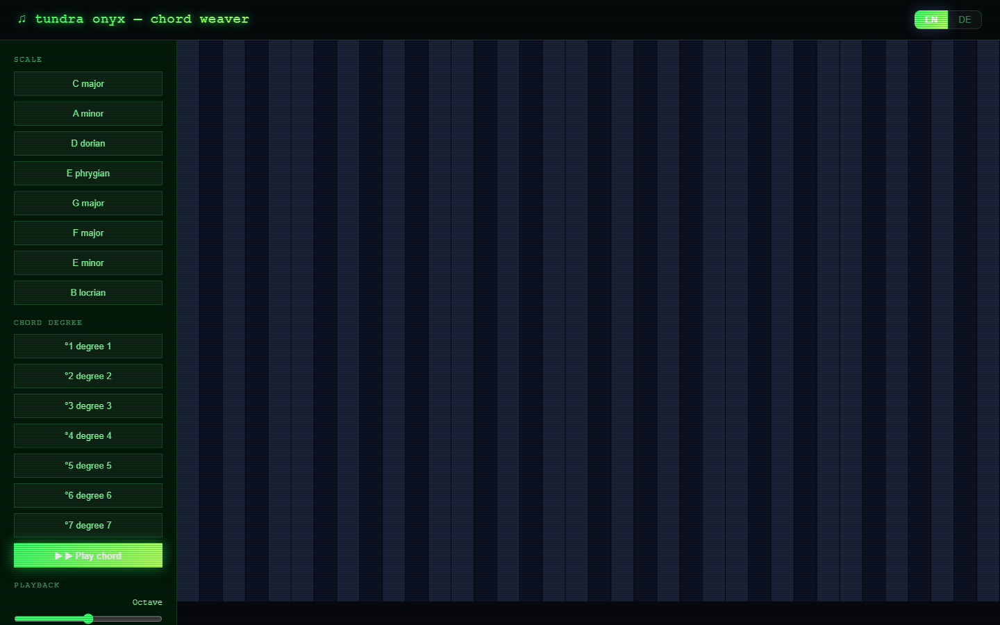
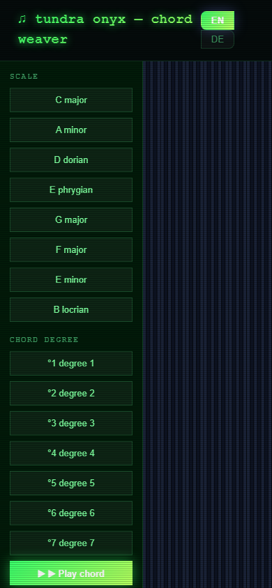

# Tundra Onyx — Chord Weaver

A chord explorer for C major: pick any of 7 diatonic degrees across 8 scales, hear C-rooted triads through Web Audio and see them on a piano-roll canvas.

<div align="center">


**[Live Demo](https://ruslanfridenli.github.io/tundra-onyx/)** · **[Deutsch ↓](#-deutsch)**

</div>

---

## Screenshots






## Features

- 8 scales × 7 diatonic chord degrees
- Web Audio triad playback with octave & duration control
- Live piano-roll visualization of chord tones
- Auto-detected chord quality (maj/min/dim/aug)
- Responsive canvas rendering
- English/German interface

## Local development

```bash
git clone https://github.com/ruslanfridenli/tundra-onyx.git
cd tundra-onyx
# open index.html in a browser, or serve statically:
npx serve .
```

No build step, no dependencies — pure static site.

---

## 🇩🇪 Deutsch

### Tundra Onyx — Chord Weaver

Ein Akkord-Explorer für C major: Alle 7 diatonischen Stufen aus 8 Tonleitern wählen, C-Akkorde über Web Audio hören und auf einem Piano-Roll-Canvas sehen.

### Funktionen

- 8 Tonleitern × 7 diatonische Akkordstufen
- Web-Audio-Triaden mit Oktav-/Dauer-Reglern
- Live-Piano-Roll-Visualisierung der Akkordtöne
- Automatische Akkordqualität (Dur/Moll/verm./überm.)
- Responsives Canvas-Rendering
- Englische/deutsche Oberfläche

### Lokale Entwicklung

```bash
git clone https://github.com/ruslanfridenli/tundra-onyx.git
cd tundra-onyx
npx serve .
```

Reine statische Seite — kein Build-Schritt, keine Abhängigkeiten.

---

## ☕ Support / Unterstützen

Wenn dir diese Website beim Lernen hilft, würde mir eine Spende sehr viel bedeuten und dabei helfen, sie weiterzuentwickeln. Alternativ kannst du das Projekt mit einem Stern im github repo unterstützen. Vielen Dank!

- Solana: `zQpgZ6nGigww7vYpz3Qqxb1BT44kqS567vFaLTeHagS`
- Ethereum: `0x9c4fE1B2e9a1A9c22312c8296BB088Ca0e8F1B4e`
- Bitcoin: `bc1p2jltk9ya9kyzv35d8kxn7mmg9jqkx66cqtgzqwe75zlr4v9jk4hsv468q7`

---

Made with care. Feedback welcome via issues.
